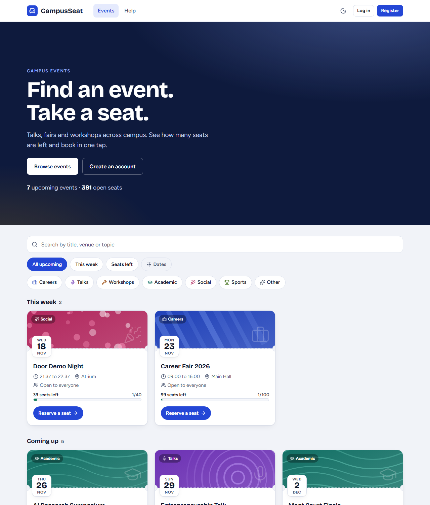

# CampusSeat

Web system for reserving seats at university events. Students and staff browse events and book a seat online. Admins create events, limit them to schools, and see bookings, reports and audit logs. Software Engineering project, Group 4.



## Live links

| What | Link |
| --- | --- |
| Website | [https://campusseat.onrender.com/](https://campusseat.onrender.com/) |
| API health check | [https://campusseat.onrender.com/api/health](https://campusseat.onrender.com/api/health) |


> The site runs on Render's free plan, which puts the server to sleep when it is idle. The first request after a quiet period can take up to a minute. Refresh and wait.

## Stack and why

| Part | Choice | Why |
| --- | --- | --- |
| Database | MySQL (`campusseat_db` locally, [Aiven](https://aiven.io/) in production) | Matches the group's schema. InnoDB enforces foreign keys and gives row locks for safe booking. |
| Backend | Node.js, Express | Same JavaScript on both sides. Prepared statements (`mysql2`), `bcryptjs` hashing, JWT login, `pdfkit` for cards and reports. |
| Frontend | React, Vite, React Router | Component and page structure, fast builds. Light and dark theme through CSS custom properties. |
| Hosting | [Render](https://render.com/) (app) and Aiven (database) | Free tiers, one service serves both the API and the built frontend. |

## What is built 

|  item | Where |
| --- | --- |
| Front-end, admin panel, database, both connected | [`frontend/`](frontend/), [`frontend/src/pages/admin/`](frontend/src/pages/admin/), [`backend/migrations/`](backend/migrations/) |
| Main transaction (booking) | [`backend/src/routes/bookings.js`](backend/src/routes/bookings.js): one transaction, locks the event row, checks duplicate, school eligibility and capacity |
| Levels of access, login, logout, register, forgot password | [`backend/src/routes/auth.js`](backend/src/routes/auth.js), [`middleware/auth.js`](backend/src/middleware/auth.js): httpOnly cookie sessions, CSRF protection, emailed single-use reset links, optional two-factor login for admins |
| Cancellation and waitlist | People cancel their own booking (until 2 hours before); full events have a waitlist and the first person in line gets a freed seat automatically ([`backend/src/seats.js`](backend/src/seats.js)) |
| Add, edit, delete, browse and search | Events (admin), users, bookings; search and filters on events, bookings, users, logs |
| Reports with date, name and filters | Admin > Reports: PDF and CSV, filter by date, event, school, sort |
| Audit logs | Every login, booking, event change, reset and report is recorded with who and when |
| Security | Hashed passwords, prepared statements, login rate limits and account lockout, role checks on every admin route, strict security headers (CSP), secrets never logged |
| Validation and error messages | Server rules in [`utils/validate.js`](backend/src/utils/validate.js); field-level messages in every form |
| Help facilities | Help page in the app |
| Registration card | PDF with QR code, plus on-screen card |

## API

Base URL: `https://campusseat.onrender.com/api` (locally `http://localhost:4000/api`).

Endpoints marked **Public** can be opened straight in the browser. The rest need a login session (an httpOnly cookie set by `/auth/login`). Requests that change something (POST, PUT, PATCH, DELETE) must also send the `X-CSRF-Token` header with the token returned by `/auth/login` or `/auth/session`; the web app does this for you.

Lists return `{ <items>: [...], meta: { page, limit, total, pages, sort, dir } }` and accept `?page=&limit=` (max 100) `&sort=&dir=asc|desc`. Errors return `{ error: { code, message, field?, request_id } }`.

| Method | Endpoint | Access | Purpose |
| --- | --- | --- | --- |
| GET | [`/health`](https://campusseat.onrender.com/api/health) | Public | Liveness, includes a database check (503 if the database is down) |
| GET | [`/ready`](https://campusseat.onrender.com/api/ready) | Public | Readiness: database reachable and migrations up to date |
| GET | [`/schools`](https://campusseat.onrender.com/api/schools) | Public | List of schools for the register form |
| GET | [`/events`](https://campusseat.onrender.com/api/events) | Public | Browse and search events (paginated, `sort=date|title|seats|created`) |
| GET | `/events/:id` | Public | One event with seats left and waitlist length |
| POST | `/auth/register` | Public | Create an account (starts a session) |
| POST | `/auth/login` | Public | Log in; returns `{ mfa_required, challenge }` instead when two-factor is on |
| POST | `/auth/2fa` | Public | Second login step: app code or backup code |
| GET | `/auth/session` | Public | Who is logged in (or `null`) and the CSRF token |
| POST | `/auth/forgot-password` | Public | Email a single-use reset link |
| POST | `/auth/reset-password`, `/auth/reset-password/verify` | Public | Set a new password with the emailed token |
| POST | `/auth/logout`, `/auth/logout-all` | Logged in | End this session, or every session of the account |
| GET | `/auth/me` | Logged in | Current user |
| POST | `/auth/change-password` | Logged in | Change own password (logs out other devices) |
| GET, POST | `/account/2fa`, `/account/2fa/setup`, `/enable`, `/disable`, `/backup-codes` | Logged in (setup: admin) | Two-factor login settings |
| POST | `/bookings` | Logged in | Book a seat |
| GET | `/bookings/mine`, `/bookings/waitlist` | Logged in | My bookings, my waitlist places |
| DELETE | `/bookings/:id` | Owner or admin | Cancel a booking (owner: until `CANCEL_CUTOFF_HOURS` before the start) |
| POST, DELETE | `/events/:id/waitlist` | Logged in | Join or leave the waitlist of a full event |
| GET | `/bookings/:id/card` | Logged in | Registration card (PDF with QR code) |
| GET | `/bookings`, `/events/:id/waitlist` | Admin | All bookings, an event's waitlist |
| POST, PUT, DELETE | `/events`, `/events/:id` | Admin | Create, edit, delete events (more capacity promotes waiting people) |
| GET | `/admin/stats`, `/admin/event-options` | Admin | Dashboard numbers, event picker |
| GET, PATCH, DELETE | `/admin/users`, `/admin/users/:id` | Admin | Manage users |
| POST | `/admin/users/:id/send-reset-email`, `/reset-password`, `/unlock` | Admin | Email a reset link, set a temporary password, unlock a locked account |
| GET | `/admin/audit-logs` | Admin | Audit log |
| GET | `/admin/reports/:type` | Admin | PDF and CSV reports |

## Run it on Windows

**Quickest: Docker.** With [Docker Desktop](https://www.docker.com/products/docker-desktop/) running:

```
docker compose up --build
```

Open [http://localhost:8080](http://localhost:8080). This starts MySQL 8.4 and the app, applies the migrations and adds the demo data. Emails (reset links, waitlist news) are printed in `docker compose logs -f app`.

**Without Docker:**

1. Install [Node.js](https://nodejs.org/) 22 or newer and [MySQL Server 8](https://dev.mysql.com/downloads/mysql/). Create an empty database, e.g. `mysql -u root -p -e "CREATE DATABASE campusseat_db CHARACTER SET utf8mb4"`.
2. Backend settings. Copy the example file and fill in the database values (every setting is explained in the file):

```
cd backend
copy .env.example .env
notepad .env
```

3. Install, create the tables, add starter data, and start the API:

```
npm install
npm run migrate
npm run seed
npm start
```

4. In a second PowerShell window, build the frontend:

```
cd frontend
npm install
npm run build
```

5. Open [http://localhost:4000](http://localhost:4000). The backend serves the built frontend.

For development with live reload, run `npm run dev` in `frontend` and open [http://localhost:5173](http://localhost:5173). With `MAIL_DRIVER=console` (the default outside production) emails are printed in the API's terminal.

### Database migrations

The schema lives in numbered files in [`backend/migrations/`](backend/migrations/). `npm run migrate` applies the ones not yet applied and records them in `schema_migrations`; `npm run migrate -- status` lists them and `npm run migrate -- --dry-run` shows what would change. On a database created from the old `database/schema.sql`, the first migration is recognised as already applied.

### Starter data and demo accounts

`npm run seed` adds the schools, sample events, an admin account (`admin@campusseat.local`) and a demo student (`student@campusseat.local`). Their passwords come from `SEED_ADMIN_PASSWORD` and `SEED_DEMO_PASSWORD` in `backend/.env`, so set your own before seeding. The seed skips accounts that already exist, so it is safe to run more than once.

## Deploying (Render + Aiven)

1. **Database.** Create a MySQL service on Aiven and copy its host, port, user, password and database name.
2. **Back it up before migrating.** For an existing database, take a backup first (Aiven console > Backups, or `mysqldump`).
3. **Migrate and seed from your computer.** Put the Aiven values in `backend/.env` with `DB_SSL=true` (and ideally `DB_SSL_CA`), then:

```
cd backend
npm install
npm run migrate -- --dry-run
npm run migrate
npm run seed
```

   Migration 002 moves all timestamps to UTC. On a database that already has data it needs `TZ_CUTOVER_UTC`: the UTC time the "Use Kenyan time zone for database connections" deploy went live (from the Render deploy history), e.g. `TZ_CUTOVER_UTC=2026-11-17T17:40:00Z`. The dry run shows how many rows it will change.
4. **Web service.** Create a Render web service from this repo (or use the [`Dockerfile`](Dockerfile)). Build: install and build the frontend, install the backend. Start (root directory `backend`): `npm run migrate && npm start`, so new migrations apply on every deploy; ones already applied are skipped in about a second, and a lock stops two instances migrating at once. (On a paid Render plan you can use the pre-deploy command `npm run migrate` instead.) Set the health check path to `/api/ready`.
5. **Environment variables on Render.** Render does not read your local `.env`. Required in production:

| Variable | Value |
| --- | --- |
| `NODE_ENV` | `production` |
| `APP_URL` | `https://campusseat.onrender.com` (your public address) |
| `DB_HOST`, `DB_PORT`, `DB_USER`, `DB_PASSWORD`, `DB_NAME`, `DB_SSL=true` | From Aiven (`DB_SSL_CA` recommended) |
| `TOTP_ENC_KEY` | 32 random bytes, base64: `node -e "console.log(require('crypto').randomBytes(32).toString('base64'))"`. Keep it stable. |
| `MAIL_DRIVER`, `MAIL_FROM` | `resend` (works on Render's free tier) or `smtp`, and a sender on a domain verified with the provider |
| `RESEND_API_KEY` or `SMTP_HOST`, `SMTP_PORT`, `SMTP_USER`, `SMTP_PASS` | Credentials for the chosen mail driver |

Optional: `CANCEL_CUTOFF_HOURS` (2), `SESSION_IDLE_MINUTES` (120), `SESSION_MAX_DAYS` (7), `LOCKOUT_THRESHOLD` (5), `LOCKOUT_MINUTES` (15), `RESET_TOKEN_MINUTES` (30), `LOG_LEVEL` (info). The app refuses to start, listing every problem, if a required value is missing or unsafe. `JWT_SECRET` is no longer used and can be removed.

## Tests

The end-to-end tests need the API running against a **test database** (never the live one), with `NODE_ENV=test`, `MAIL_DRIVER=memory` (so tests can read the emails) and `RATE_LIMIT_SCALE=50`:

```
cd backend
npm run migrate
npm run seed
npm start          # in one window, with the test settings above
npm test           # in another
```

175 checks cover login, sessions and CSRF, account lockout, emailed password resets, two-factor login, access control, SQL injection attempts, event rules, time zones, booking rules, 25 simultaneous requests for 4 seats (exactly 4 succeed), cancellations and waitlist races, pagination, PDFs, reports, CSV formula injection, audit logs, health checks and startup configuration checks. GitHub Actions ([`.github/workflows/ci.yml`](.github/workflows/ci.yml)) runs them on every push against a fresh MySQL 8.4.

## Folders

```
backend/    Express API (routes, middleware, PDF utilities, seed and test scripts)
frontend/   React app (pages, admin pages, components, theme)
database/   schema.sql and schema_hosted.sql
docs/       requirements, schema, diagrams, UI mockups
```

## Documentation

| Document | Link |
| --- | --- |
| Requirements | [docs/Requirements.md](docs/Requirements.md) |
| Database schema | [docs/Database_Schema.md](docs/Database_Schema.md) |
| Progress and testing report | [docs/Progress_and_Testing_Report.md](docs/Progress_and_Testing_Report.md) |
| User manual (PDF) | [docs/CampusSeat_User_Manual.pdf](docs/CampusSeat_User_Manual.pdf) |
| User manual (Word) | [docs/CampusSeat_User_Manual.docx](docs/CampusSeat_User_Manual.docx) |
| Deliverables 1 and 2 | [docs/Group 4 Deliverables 1 and 2.pdf](docs/Group%204%20Deliverables%201%20and%202.pdf) |
| Project brief | [docs/Software Engineering Project.pdf](docs/Software%20Engineering%20Project.pdf) |

### Diagrams

| Diagram | Image | Editable source |
| --- | --- | --- |
| Use case | [use-case.png](docs/diagrams/use-case.png) | [CampusSeat_UseCase.drawio](docs/diagrams/source/CampusSeat_UseCase.drawio) |
| Class diagram | [class-diagram.png](docs/diagrams/class-diagram.png) | [CampusSeat_ClassDiagram.drawio](docs/diagrams/source/CampusSeat_ClassDiagram.drawio) |
| ER diagram | [er-diagram.png](docs/diagrams/er-diagram.png) | [CampusSeat_ER.drawio](docs/diagrams/source/CampusSeat_ER.drawio) |
| Flow chart | [flow-chart.png](docs/diagrams/flow-chart.png) | |

### UI mockups

Screens 1 to 9 are in [`docs/mockups/`](docs/mockups/): [screen-1](docs/mockups/screen-1.png), [screen-2](docs/mockups/screen-2.png), [screen-3](docs/mockups/screen-3.png), [screen-4](docs/mockups/screen-4.png), [screen-5](docs/mockups/screen-5.png), [screen-6](docs/mockups/screen-6.png), [screen-7](docs/mockups/screen-7.png), [screen-8](docs/mockups/screen-8.png), [screen-9](docs/mockups/screen-9.png).

## Team

| Member | Part |
| --- | --- |
| Edenmike Mwaura Ruhanga | Frontend |
| Uthman Salyani | Backend |
| Rick Kyalo | Documentation, diagrams and mockups |

## Notes

- Never commit `backend/.env` (or any `.env.*` file). It holds your database password and keys.
- Login uses a server-side session in an httpOnly cookie; nothing secret is kept in `localStorage`. Logging out ends the session on the server.
- Times are stored in UTC and shown in Africa/Nairobi time (EAT).
- Registration always creates a normal user account. Admin accounts are created by the seed script or promoted by an existing admin, never through the sign-up form.
