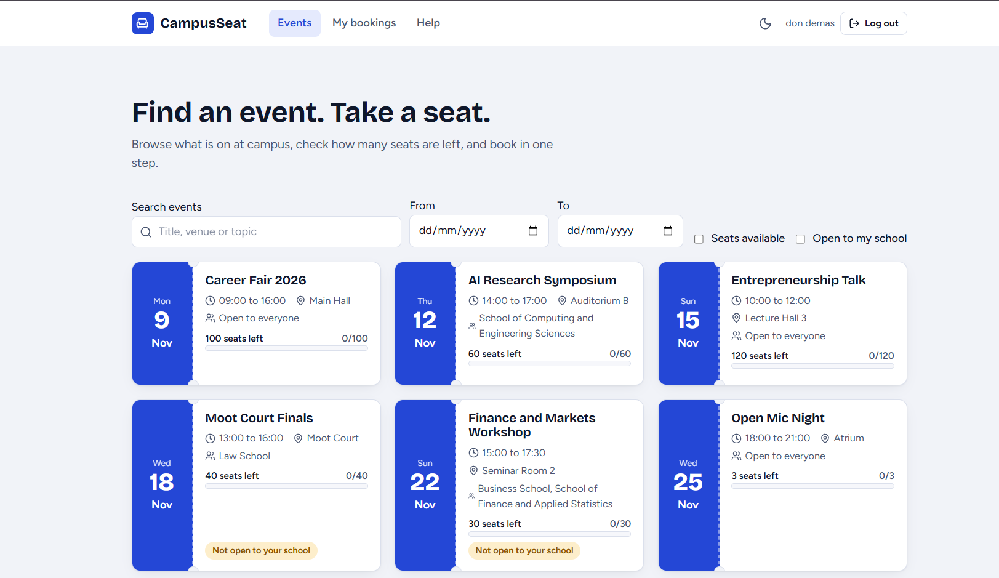

# CampusSeat

Web system for reserving seats at university events. Students and staff browse events and book a seat online. Admins create events, limit them to schools, and see bookings, reports and audit logs. Software Engineering project, Group 4.



## Live links

| What | Link |
| --- | --- |
| Website | [https://campusseat.onrender.com/](https://campusseat.onrender.com/) |
| API health check | [https://campusseat.onrender.com/api/health](https://campusseat.onrender.com/api/health) |


> The site runs on Render's free plan, which puts the server to sleep when it is idle. The first request after a quiet period can take up to a minute. Refresh and wait.

## Stack and why

| Part | Choice | Why |
| --- | --- | --- |
| Database | MySQL (`campusseat_db` locally, [Aiven](https://aiven.io/) in production) | Matches the group's schema. InnoDB enforces foreign keys and gives row locks for safe booking. |
| Backend | Node.js, Express | Same JavaScript on both sides. Prepared statements (`mysql2`), `bcryptjs` hashing, JWT login, `pdfkit` for cards and reports. |
| Frontend | React, Vite, React Router | Component and page structure, fast builds. Light and dark theme through CSS custom properties. |
| Hosting | [Render](https://render.com/) (app) and Aiven (database) | Free tiers, one service serves both the API and the built frontend. |

## What is built 

|  item | Where |
| --- | --- |
| Front-end, admin panel, database, both connected | [`frontend/`](frontend/), [`frontend/src/pages/admin/`](frontend/src/pages/admin/), [`database/schema.sql`](database/schema.sql) |
| Main transaction (booking) | [`backend/src/routes/bookings.js`](backend/src/routes/bookings.js): one transaction, locks the event row, checks duplicate, school eligibility and capacity |
| Levels of access, login, logout, register, forgot password | [`backend/src/routes/auth.js`](backend/src/routes/auth.js), [`middleware/auth.js`](backend/src/middleware/auth.js); admin can also reset passwords |
| Add, edit, delete, browse and search | Events (admin), users, bookings; search and filters on events, bookings, users, logs |
| Reports with date, name and filters | Admin > Reports: PDF and CSV, filter by date, event, school, sort |
| Audit logs | Every login, booking, event change, reset and report is recorded with who and when |
| Security | Hashed passwords, prepared statements, login rate limits, role checks on every admin route, security headers |
| Validation and error messages | Server rules in [`utils/validate.js`](backend/src/utils/validate.js); field-level messages in every form |
| Help facilities | Help page in the app |
| Registration card | PDF with QR code, plus on-screen card |

## API

Base URL: `https://campusseat.onrender.com/api` (locally `http://localhost:4000/api`).

Endpoints marked **Public** can be opened straight in the browser. Everything else needs a login token, and admin routes need an admin account.

| Method | Endpoint | Access | Purpose |
| --- | --- | --- | --- |
| GET | [`/health`](https://campusseat.onrender.com/api/health) | Public | Server check, returns `{"ok":true}` |
| GET | [`/schools`](https://campusseat.onrender.com/api/schools) | Public | List of schools for the register form |
| GET | [`/events`](https://campusseat.onrender.com/api/events) | Public | Browse and search events |
| GET | `/events/:id` | Public | One event with seats left |
| POST | `/auth/register` | Public | Create an account |
| POST | `/auth/login` | Public | Log in, returns a token |
| POST | `/auth/forgot-password` | Public | Reset password with email and student/staff number |
| POST | `/auth/logout` | Logged in | Log out |
| GET | `/auth/me` | Logged in | Current user |
| POST | `/auth/change-password` | Logged in | Change own password |
| POST | `/bookings` | Logged in | Book a seat |
| GET | `/bookings/mine` | Logged in | My bookings |
| GET | `/bookings/:id/card` | Logged in | Registration card (PDF with QR code) |
| GET | `/bookings` | Admin | All bookings |
| DELETE | `/bookings/:id` | Admin | Cancel a booking |
| POST, PUT, DELETE | `/events`, `/events/:id` | Admin | Create, edit, delete events |
| GET | `/admin/stats` | Admin | Dashboard numbers |
| GET, PATCH, DELETE | `/admin/users`, `/admin/users/:id` | Admin | Manage users |
| POST | `/admin/users/:id/reset-password` | Admin | Reset a user's password |
| GET | `/admin/audit-logs` | Admin | Audit log |
| GET | `/admin/reports/:type` | Admin | PDF and CSV reports |

## Run it on Windows

1. Install [Node.js](https://nodejs.org/) (LTS) and [MySQL Server 8](https://dev.mysql.com/downloads/mysql/). Remember the MySQL root password.
2. Create the database and tables. In PowerShell, from the project folder:

```
mysql -u root -p -e "source database/schema.sql"
```

3. Backend settings. Copy the example file and edit the values (use `root` and your MySQL password for `DB_USER` and `DB_PASSWORD`, and paste a long random string as `JWT_SECRET`):

```
cd backend
copy .env.example .env
notepad .env
```

4. Install, add starter data, and start the API:

```
npm install
npm run seed
npm start
```

5. In a second PowerShell window, build the frontend:

```
cd frontend
npm install
npm run build
```

6. Open [http://localhost:4000](http://localhost:4000). The backend serves the built frontend.

For development with live reload, run `npm run dev` in `frontend` and open [http://localhost:5173](http://localhost:5173).

### Starter data and demo accounts

`npm run seed` adds the schools, sample events, an admin account (`admin@campusseat.local`) and a demo student (`student@campusseat.local`). Their passwords come from `SEED_ADMIN_PASSWORD` and `SEED_DEMO_PASSWORD` in `backend/.env`, so set your own before seeding. The seed skips accounts that already exist, so it is safe to run more than once.

## Deployment
Hosted on Render with an Aiven MySQL database. Set the `DB_*`, `DB_SSL=true`, `JWT_SECRET` and `NODE_ENV=production` variables on Render, and run `npm run seed` once against the database.

## Tests

With the API running and seeded:

```
cd backend
npm test
```

47 checks cover login, access control, SQL injection attempts, event rules, booking rules, 25 simultaneous requests for 4 seats (exactly 4 succeed), PDFs, reports, audit logs and password reset.

## Folders

```
backend/    Express API (routes, middleware, PDF utilities, seed and test scripts)
frontend/   React app (pages, admin pages, components, theme)
database/   schema.sql and schema_hosted.sql
docs/       requirements, schema, diagrams, UI mockups
```

## Documentation

| Document | Link |
| --- | --- |
| Requirements | [docs/Requirements.md](docs/Requirements.md) |
| Database schema | [docs/Database_Schema.md](docs/Database_Schema.md) |
| Progress and testing report | [docs/Progress_and_Testing_Report.md](docs/Progress_and_Testing_Report.md) |
| User manual (PDF) | [docs/CampusSeat_User_Manual.pdf](docs/CampusSeat_User_Manual.pdf) |
| User manual (Word) | [docs/CampusSeat_User_Manual.docx](docs/CampusSeat_User_Manual.docx) |
| Deliverables 1 and 2 | [docs/Group 4 Deliverables 1 and 2.pdf](docs/Group%204%20Deliverables%201%20and%202.pdf) |
| Project brief | [docs/Software Engineering Project.pdf](docs/Software%20Engineering%20Project.pdf) |

### Diagrams

| Diagram | Image | Editable source |
| --- | --- | --- |
| Use case | [use-case.png](docs/diagrams/use-case.png) | [CampusSeat_UseCase.drawio](docs/diagrams/source/CampusSeat_UseCase.drawio) |
| Class diagram | [class-diagram.png](docs/diagrams/class-diagram.png) | [CampusSeat_ClassDiagram.drawio](docs/diagrams/source/CampusSeat_ClassDiagram.drawio) |
| ER diagram | [er-diagram.png](docs/diagrams/er-diagram.png) | [CampusSeat_ER.drawio](docs/diagrams/source/CampusSeat_ER.drawio) |
| Flow chart | [flow-chart.png](docs/diagrams/flow-chart.png) | |

### UI mockups

Screens 1 to 9 are in [`docs/mockups/`](docs/mockups/): [screen-1](docs/mockups/screen-1.png), [screen-2](docs/mockups/screen-2.png), [screen-3](docs/mockups/screen-3.png), [screen-4](docs/mockups/screen-4.png), [screen-5](docs/mockups/screen-5.png), [screen-6](docs/mockups/screen-6.png), [screen-7](docs/mockups/screen-7.png), [screen-8](docs/mockups/screen-8.png), [screen-9](docs/mockups/screen-9.png).

## Team

| Member | Part |
| --- | --- |
| Edenmike Mwaura Ruhanga | Frontend |
| Uthman Salyani | Backend |
| Rick Kyalo | Documentation, diagrams and mockups |

